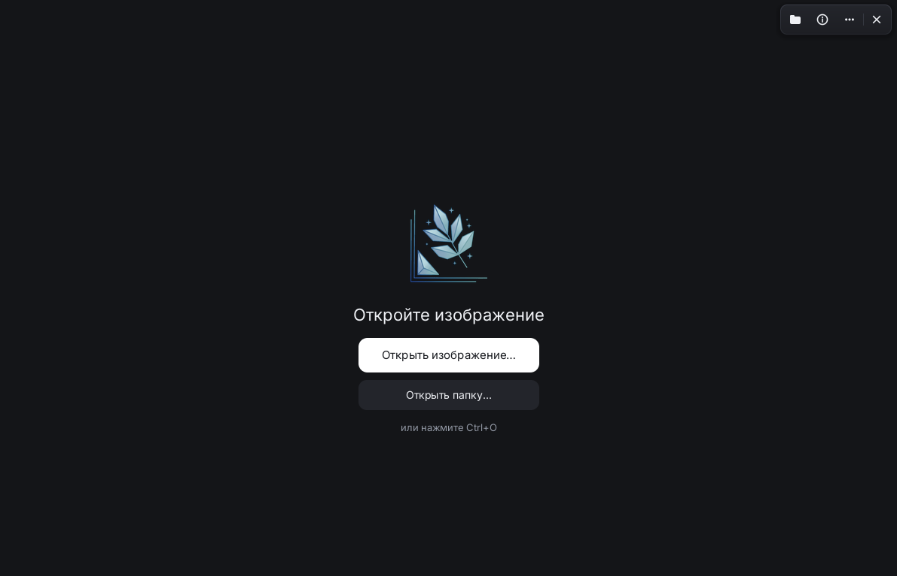
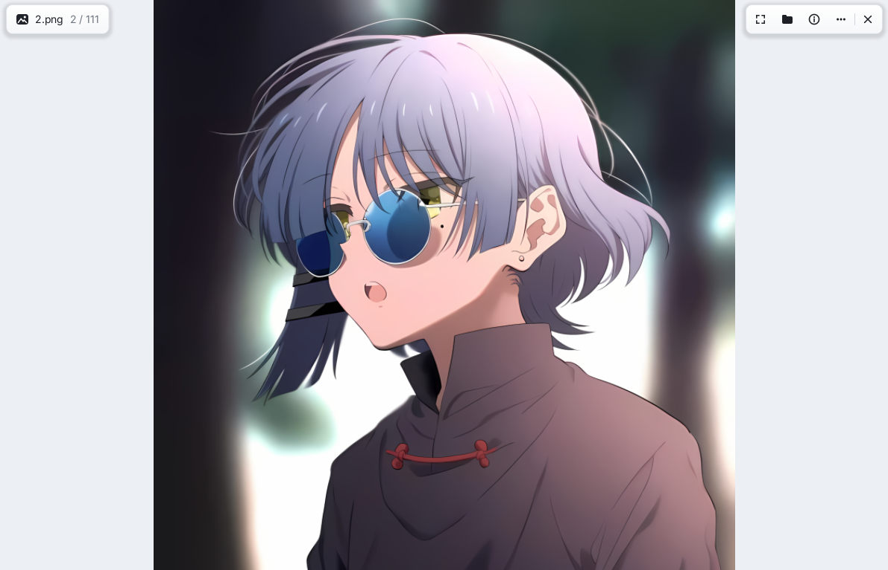
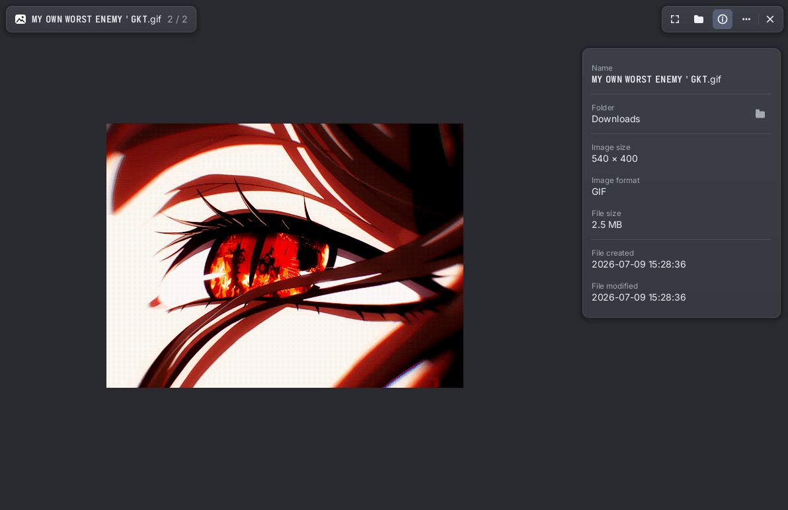

<div align="center">


# Mithril Viewer

**A fast, minimal image viewer for Linux.**
Works smoothly on both **tiling WMs** (Hyprland, Sway, Niri, i3) and **desktop environments** (GNOME, KDE Plasma, XFCE) over Wayland and X11.


English · [Русский](README.ru.md)

</div>

---

## Screenshots

|                   Dark theme (start screen)                   |                      Light theme (viewer)                      |                       Neutral theme (GIF + info panel)                       |
| :-----------------------------------------------------------: | :------------------------------------------------------------: | :--------------------------------------------------------------------------: |
|  |  |  |

## What it does

- **Formats:** PNG, APNG, JPEG, GIF, WebP (animated too), BMP, SVG, AVIF, ICO, TIFF, QOI
- **Smooth & fast:** GPU-accelerated rendering, cursor-centered zoom, drag to pan, `F11` fullscreen, and background preloading for neighbor images
- **Quick edits:** rotate, flip horizontally/vertically, visual crop — originals are never overwritten (saves as a copy and warns before closing)
- **Themes & UI:** dark, neutral, and light themes, adjustable window opacity, and 6 languages (English, Русский, Українська, Deutsch, Français, Español)
- **Desktop integration:** drag & drop, clipboard copy, CUPS printing, move to trash or delete, and **Set as wallpaper** (Hyprland, Sway, swww/awww, feh, KDE Plasma, GNOME)

## Installation

### Flatpak (any Linux distro)

Flatpak manifest and build instructions are in [`packaging/flatpak/README.md`](packaging/flatpak/README.md).

### Arch Linux (AUR)

```sh
yay -S mithril-viewer-git
```

Packaging files: [`packaging/arch/PKGBUILD`](packaging/arch/PKGBUILD).

### Build from source

Requires Rust 1.85+ (edition 2024) and runtime libraries (`dav1d`, `libglvnd`, `libxkbcommon`, `wayland`, `libx11`, `fontconfig`).

```sh
git clone https://github.com/pzwt4cc/mithril-viewer.git
cd mithril-viewer
cargo build --release
```

To install system-wide with app menu and "Open with" support:

```sh
sudo install -Dm755 target/release/mithril-viewer /usr/local/bin/mithril-viewer
sudo install -Dm644 data/io.github.pzwt4cc.mithril-viewer.desktop /usr/local/share/applications/io.github.pzwt4cc.mithril-viewer.desktop
sudo install -Dm644 data/io.github.pzwt4cc.mithril-viewer.metainfo.xml /usr/local/share/metainfo/io.github.pzwt4cc.mithril-viewer.metainfo.xml
sudo cp -r data/icons/hicolor /usr/local/share/icons/
sudo gtk-update-icon-cache -f /usr/local/share/icons/hicolor 2>/dev/null || true
```

## Shortcuts

| Key                              | Action                               |
| -------------------------------- | ------------------------------------ |
| `←` / `→`, `PageUp` / `PageDown` | Previous / next image                |
| Mouse wheel                      | Zoom at cursor                       |
| `0`                              | Reset zoom                           |
| `F11`                            | Toggle fullscreen                    |
| `R` / `Shift+R`                  | Rotate clockwise / counter-clockwise |
| `Ctrl+R` / `Ctrl+Shift+R`        | Flip horizontally / vertically       |
| `C`                              | Crop (`Enter` apply, `Esc` cancel)   |
| `Ctrl+C`                         | Copy image to clipboard              |
| `Ctrl+P`                         | Print                                |
| `Delete`                         | Delete image                         |
| `I`                              | Toggle info panel                    |
| `Esc`                            | Close menu / cancel crop / quit      |

Right-click anywhere on the image for the context menu, or click `⋯` in the top-right corner for settings.

## License

MIT License — see [`LICENSE`](LICENSE).
Bundled [Inter](https://rsms.me/inter/) font is licensed under SIL OFL 1.1 — see [`assets/fonts/OFL.txt`](assets/fonts/OFL.txt).

Maintained by [pzwt4cc](https://github.com/pzwt4cc). Built with the help of AI (Claude by Anthropic).
