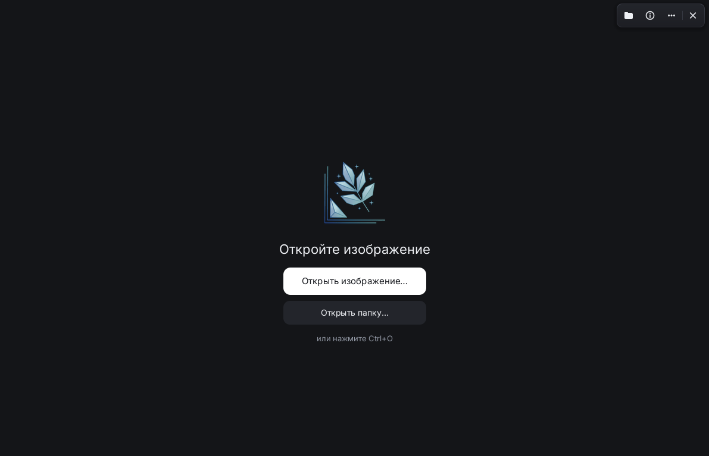
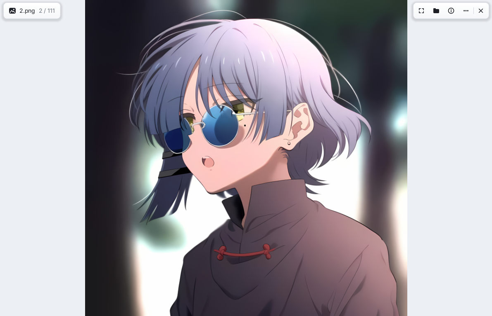
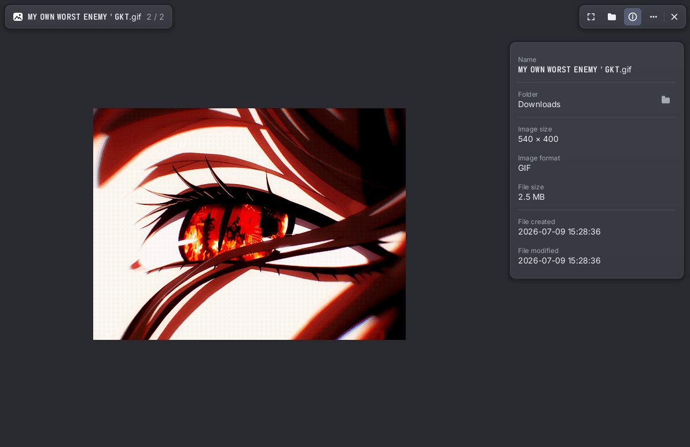

<div align="center">


# Mithril Viewer

**Быстрый и минималистичный просмотрщик изображений для Linux.**
Удобен как в **тайловых WM** (Hyprland, Sway, Niri, i3), так и в **обычных DE** (GNOME, KDE Plasma, XFCE) — работает на Wayland и X11.


[English](README.md) · Русский

</div>

---

## Скриншоты

|            Тёмная тема (главный экран)            |             Светлая тема (просмотр фото)             |              Нейтральная тема (GIF + свойства)               |
| :-----------------------------------------------: | :--------------------------------------------------: | :----------------------------------------------------------: |
|  |  |  |

## Что умеет

- **Форматы:** PNG, APNG, JPEG, GIF, WebP (включая анимацию), BMP, SVG, AVIF, ICO, TIFF, QOI
- **Скорость и плавность:** GPU-рендеринг, зум под курсором, перетаскивание, полный экран (`F11`) и фоновая предзагрузка соседних картинок
- **Быстрые правки:** поворот, отражение по горизонтали/вертикали, обрезка — оригинал не перезаписывается (сохраняется копия, при закрытии спросит)
- **Темы и настройки:** тёмная, нейтральная и светлая темы, прозрачность окна и 6 языков (Русский, English, Українська, Deutsch, Français, Español)
- **Интеграция с системой:** drag & drop, буфер обмена, печать через CUPS, удаление в корзину или навсегда, **установка на обои** (Hyprland, Sway, swww/awww, feh, KDE Plasma, GNOME)

## Установка

### Flatpak (любой дистрибутив Linux)

Манифест и инструкция по сборке лежат в [`packaging/flatpak/README.md`](packaging/flatpak/README.md).

### Arch Linux (AUR)

```sh
yay -S mithril-viewer-git
```

Файлы сборки: [`packaging/arch/PKGBUILD`](packaging/arch/PKGBUILD).

### Сборка из исходников

Нужен Rust 1.85+ (edition 2024) и системные библиотеки (`dav1d`, `libglvnd`, `libxkbcommon`, `wayland`, `libx11`, `fontconfig`).

```sh
git clone https://github.com/pzwt4cc/mithril-viewer.git
cd mithril-viewer
cargo build --release
```

Чтобы добавить приложение в меню и «Открыть с помощью»:

```sh
sudo install -Dm755 target/release/mithril-viewer /usr/local/bin/mithril-viewer
sudo install -Dm644 data/io.github.pzwt4cc.Mithril.desktop /usr/local/share/applications/io.github.pzwt4cc.Mithril.desktop
sudo install -Dm644 data/io.github.pzwt4cc.Mithril.metainfo.xml /usr/local/share/metainfo/io.github.pzwt4cc.Mithril.metainfo.xml
sudo cp -r data/icons/hicolor /usr/local/share/icons/
sudo gtk-update-icon-cache -f /usr/local/share/icons/hicolor 2>/dev/null || true
```

## Горячие клавиши

| Клавиша                          | Действие                                  |
| -------------------------------- | ----------------------------------------- |
| `←` / `→`, `PageUp` / `PageDown` | Предыдущее / следующее изображение        |
| Колесо мыши                      | Зум под курсором                          |
| `0`                              | Сбросить зум                              |
| `F11`                            | Полный экран                              |
| `R` / `Shift+R`                  | Повернуть по часовой / против часовой     |
| `Ctrl+R` / `Ctrl+Shift+R`        | Отразить по горизонтали / вертикали       |
| `C`                              | Обрезка (`Enter` применить, `Esc` отмена) |
| `Ctrl+C`                         | Скопировать в буфер обмена                |
| `Ctrl+P`                         | Печать                                    |
| `Delete`                         | Удалить изображение                       |
| `I`                              | Показать / скрыть панель свойств          |
| `Esc`                            | Закрыть меню / отменить обрезку / выйти   |

ПКМ по картинке открывает контекстное меню, кнопка `⋯` в углу — настройки.

## Лицензия

MIT — см. [`LICENSE`](LICENSE).
Встроенный шрифт [Inter](https://rsms.me/inter/) распространяется под SIL OFL 1.1 — см. [`assets/fonts/OFL.txt`](assets/fonts/OFL.txt).

Автор и мейнтейнер — [pzwt4cc](https://github.com/pzwt4cc). Проект создан при помощи ИИ (Claude от Anthropic).
